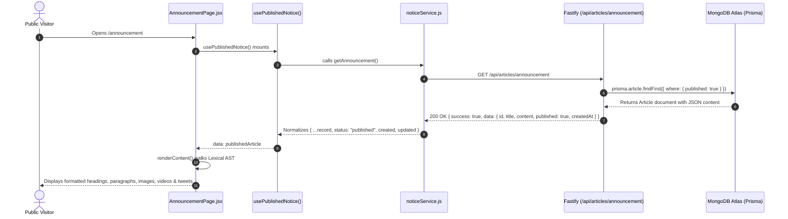
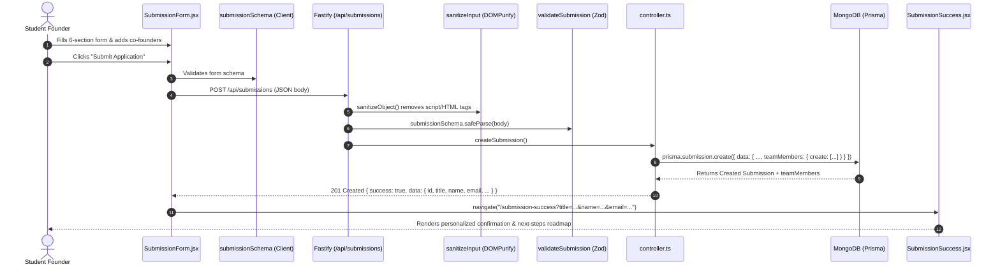
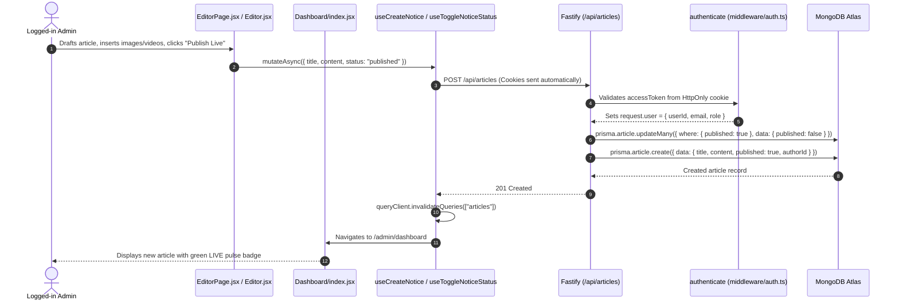
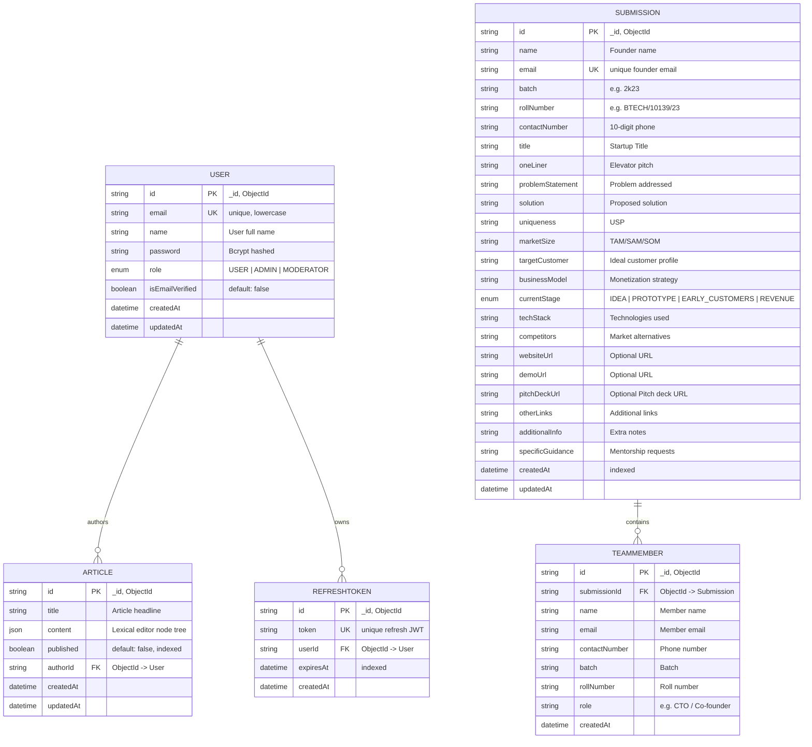
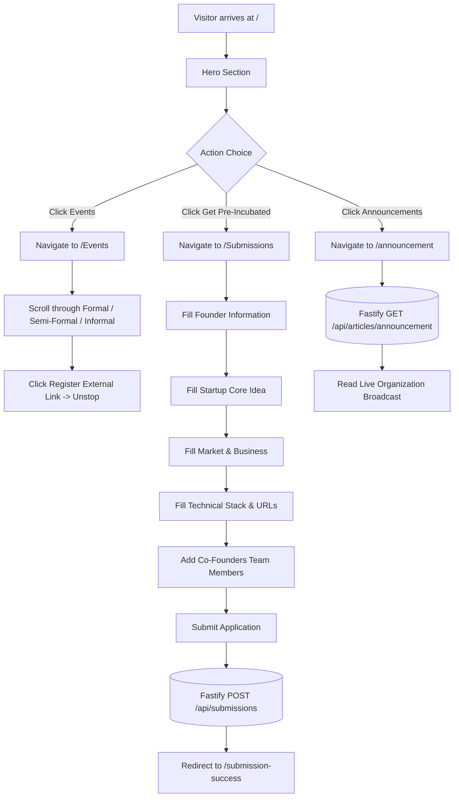
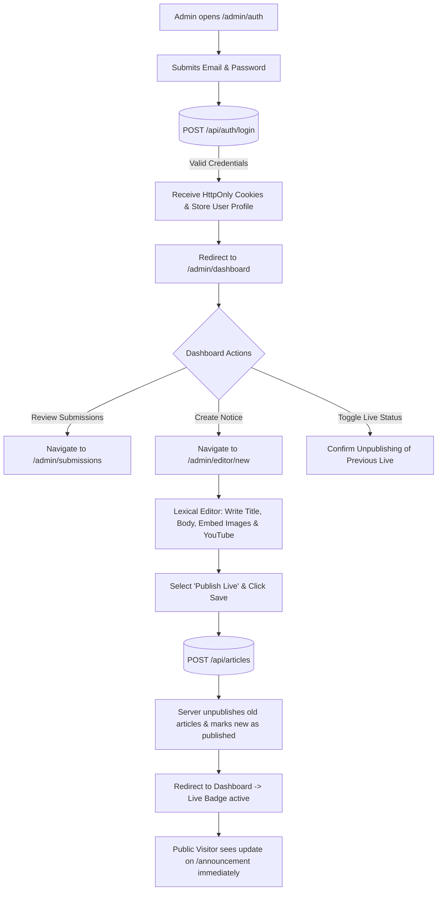

# EDC-BITM Website — Complete Page-by-Page Architecture & Data Flow Audit

**Auditor:** Senior Full-Stack Engineer & Software Architect  
**Repository:** `EDC-BITM`  
**Target:** Client Frontend (`src/`) & Backend API Server (`edc-server/`)  
**Scope:** Architectural Audit, Data Flow Tracing, Route & Page Inventory, Security & Bug Analysis  

---

## 1. Executive Summary of the Architecture

The **EDC-BITM Website** (Entrepreneurship Development Cell, Birla Institute of Technology, Mesra) is a modern full-stack web application designed to promote entrepreneurship, showcase flagship events, honor past speakers and alumni founders, deliver live organization announcements, and collect/manage student startup applications for pre-incubation.

```
┌─────────────────────────────────────────────────────────────────────────────────┐
│                                CLIENT FRONTEND                                  │
│  React 19 + Vite 7 + Tailwind CSS v4 + React Router v7 + TanStack Query v5     │
│  Framer Motion 12 + Swiper 11 + Lexical Rich-Text Editor + Cloudinary SDK       │
└───────────────────────┬─────────────────────────────────┬───────────────────────┘
                        │ HTTP / JSON                     │ Direct Client
                        │ (Cookies withCredentials: true) │ Requests
                        ▼                                 ▼
┌─────────────────────────────────────────┐     ┌─────────────────────────────────┐
│           BACKEND API SERVER            │     │       THIRD-PARTY SERVICES      │
│  Fastify v5 + TypeScript + Prisma v6    │     │  • Cloudinary (Image CDN)       │
│  JWT via jose + Cookies + Zod + Biome   │     │  • EmailJS (Footer Messages)    │
└───────────────────┬─────────────────────┘     │  • Unstop / Google Forms (Links)│
                    │ Prisma Client             │  • Twitter Widgets (Embeds)     │
                    ▼                           └─────────────────────────────────┘
┌─────────────────────────────────────────┐
│           DATABASE LAYER                │
│  MongoDB Atlas (Prisma Schema: mongo)   │
│  Collections: User, Article,            │
│  RefreshToken, Submission, TeamMember   │
└─────────────────────────────────────────┘
```

### High-Level Architectural Summary:
1. **Frontend Architecture:** Built on **React 19.1.0** and bundled with **Vite 7.0.6**. Routing is managed by **React Router DOM 7.7.1** using `createBrowserRouter` with page transitions powered by **Framer Motion 12.23.9**. The UI styling is built on **Tailwind CSS 4.1.11** using the new `@tailwindcss/vite` plugin. Asynchronous server state is orchestrated with **TanStack React Query 5.90.5**. Content management utilizes Meta’s **Lexical Editor 0.38.1** (with rich nodes for YouTube, Twitter, Resizable Images, and Dividers) and **MDX** for static blog stories. Media delivery is offloaded to **Cloudinary** (`dmjoxb8pe`).
2. **Backend Architecture:** Built with **Fastify 5.6.1** in TypeScript, running on Node.js. It features modular routing (`auth`, `article`, `submission`), input sanitization via **isomorphic-dompurify**, validation schemas with **Zod 4.1.13**, and password hashing with **bcryptjs 3.0.2**.
3. **Database Layer:** Uses **Prisma ORM 6.19** with a **MongoDB** provider (`mongodb`), modeling Users, Articles (Lexical JSON tree), RefreshTokens, Submissions, and nested TeamMembers.
4. **Authentication & Session Management:** Implements dual-token JWT using **jose 6.1.0**: a 15-minute `accessToken` and a 7-day `refreshToken` stored in `HttpOnly` cookies with automatic silent token rotation on 401 response via Axios interceptors.

---

## 2. Complete Repository Architecture Tree

```
EDC-BITM/
├── .eslintrc.cjs                      # ESLint configuration
├── .gitignore                         # Root Git ignore rules
├── bun.lock                           # Bun lockfile
├── index.html                         # SPA HTML entry point mounting #root & Ionicons
├── jsconfig.json                      # Path aliases for IDE navigation
├── package.json                       # Frontend manifest (React 19, Vite 7, Tailwind 4)
├── package-lock.json                  # NPM lockfile
├── tailwind.config.js                 # Tailwind CSS 4 theme & layout configuration
├── vercel.json                        # Vercel SPA rewrite fallback: /[^.]+ -> /
├── vite.config.js                     # Vite build configuration (MDX, SVGR, imagetools, aliases)
│
├── public/                            # Static public web assets
│   ├── blobs.png, blobR.png           # Fallback decorative background blobs
│   ├── edclogo3d.png                  # Primary 3D EDC brand mark (favicon)
│   └── NewPic_DRIE.jpg                # Photo for Dean of RIE
│
├── src/                               # Frontend source root
│   ├── main.jsx                       # Client bootstrap: QueryClientProvider & Toaster
│   ├── App.jsx                        # Route definitions, PageWrapper animation & Layouts
│   ├── Home.jsx                       # Home landing page composition
│   ├── index.css                      # Global Tailwind and font declarations
│   │
│   ├── assets/                        # Locally stored static images & logos
│   │   ├── blobs/                     # WebP blobs (blobL.png, blobR.png)
│   │   ├── blogs/                     # Blog banner images
│   │   ├── Home/testimonial/          # Mentor portraits (VC, FacAd)
│   │   └── teams/pastPresident/       # Hall of Fame past president photos
│   │
│   ├── components/                    # Reusable React UI & layout components
│   │   ├── admin/
│   │   │   └── Editor.jsx             # Full Lexical rich-text editor engine
│   │   ├── Animations/
│   │   │   ├── Counter.jsx            # Scroll-triggered numeric count-up animation
│   │   │   ├── FadeUp.jsx             # Reusable Framer Motion fade-up wrapper
│   │   │   ├── HoverTextTranslate.jsx # Hover letter-swap typography effect
│   │   │   └── Icons/                 # Animated SVG Menu & Cross hamburger icons
│   │   ├── auth/
│   │   │   └── ProtectedRoute.jsx     # [DEAD CODE] Duplicate ProtectedRoute
│   │   ├── footer/
│   │   │   └── Footer.jsx             # Site-wide footer with EmailJS contact form
│   │   ├── Home/                      # Modular sections composing the Homepage
│   │   │   ├── AboutUs/               # "About Us" glassmorphism card
│   │   │   ├── Eventsection/          # Flagship events preview cards
│   │   │   ├── Hero/                  # Hero banner, CldImage background & rocket CTA
│   │   │   ├── Slider/                # Swiper 3D coverflow photo gallery
│   │   │   ├── socials/               # Social media channel links & banner
│   │   │   ├── speakers/              # Continuous marquee of notable past speakers
│   │   │   ├── Sponser/               # Continuous requestAnimationFrame sponsor marquee
│   │   │   ├── Stats/                 # Key statistics with animated counters
│   │   │   ├── Testimonial/           # Mentors testimonial swiper
│   │   │   └── wave/                  # Continuously morphing animated SVG wave
│   │   ├── Image.jsx                  # [DEAD CODE] Unused image placeholder component
│   │   ├── Images/
│   │   │   └── CldImage.jsx           # Cloudinary SDK wrapper (lazyload, blur, responsive)
│   │   ├── layout/
│   │   │   └── Navbar.jsx             # Desktop/mobile navigation with scroll detection
│   │   ├── ProtectedRoute.jsx         # Active route auth guard checking localStorage
│   │   └── ui/                        # Radix UI / Shadcn styled primitives
│   │       ├── badge.jsx              # Status badge component
│   │       ├── button.jsx             # Dynamic button slot component
│   │       └── table.jsx              # TanStack Data Table components
│   │
│   ├── data/
│   │   └── CldImage.json              # PublicId mappings for Cloudinary images
│   │
│   ├── hooks/                         # Custom React hooks
│   │   ├── useAuth.js                 # [DEAD CODE / BUGGY] Unused auth sync hook
│   │   ├── useNotices.js              # TanStack Query hooks for Articles / Announcements
│   │   └── useSubmissions.js          # TanStack Query hooks for Startup Submissions
│   │
│   ├── otherpages/                    # Application page views
│   │   ├── admin/
│   │   │   ├── auth/authPage.jsx      # Admin login form
│   │   │   ├── dashboard/index.jsx    # Admin dashboard for article publishing
│   │   │   ├── EditorPage.jsx         # Article creation/editing page
│   │   │   ├── editorUtils.js         # Lexical JSON import/export & localStorage sync
│   │   │   └── Submissions/           # Admin startup submissions viewer
│   │   │       ├── columns.jsx        # TanStack Table column definitions
│   │   │       ├── data-table.jsx     # Reusable TanStack data table
│   │   │       ├── SubmissionDetail.jsx # Deep single submission inspection view
│   │   │       └── SubmissionList.jsx # Submissions list with stage filtering
│   │   ├── Announcement/
│   │   │   └── AnnouncementPage.jsx   # Public live announcement renderer (Lexical AST)
│   │   ├── Blogs/
│   │   │   ├── BlogLayout.jsx         # Markdown / MDX typography layout shell
│   │   │   ├── BlogPost.jsx           # Dynamic MDX post resolver & slug redirector
│   │   │   ├── Blogs.jsx              # Blog directory grid using import.meta.glob
│   │   │   └── posts/*.mdx            # 10 MDX startup stories of BIT alumni
│   │   ├── Eventspage/
│   │   │   ├── Eventspage.jsx         # Formal, Semi-Formal & Informal events directory
│   │   │   ├── Slider2.jsx            # [DEAD CODE] Unused swiper slider
│   │   │   └── Slidermain2.jsx        # [DEAD CODE] Unused slider container
│   │   ├── IAT/                       # Innovate-A-Thon 3.0 standalone landing page
│   │   │   ├── IATPage.jsx            # Root IAT landing page container
│   │   │   └── components/            # IAT-specific sections & WebGL Circular Gallery
│   │   ├── Recruitment/
│   │   │   └── RecruitmentPage.jsx    # Pulsing redirect page to external Google Form
│   │   ├── Speakerpage/
│   │   │   ├── SpeakerCard.jsx        # Individual speaker glass card with social hover
│   │   │   ├── Speakerpage.jsx        # Notable speakers directory
│   │   │   ├── speakers.js            # [DEAD CODE] Deprecated local speakers array
│   │   │   └── speakersMeta.js        # Active speakers data backed by Cloudinary
│   │   ├── Startupspage/
│   │   │   ├── Startups.jsx           # Historical timeline (1958-2024) of BIT startups
│   │   │   └── Startupspic/           # Logos of alumni companies
│   │   └── Submissions/
│   │       ├── SubmissionForm.jsx     # Multi-step student startup pre-incubation form
│   │       └── SubmissionSuccess.jsx  # Application confirmation page
│   │
│   ├── services/
│   │   └── noticeService.js           # API service adapter for articles & announcements
│   └── utils/
│       ├── api.js                     # Axios client with automatic JWT refresh interceptor
│       └── cn.js                      # clsx + tailwind-merge helper
│
└── edc-server/                        # Backend REST API Server
    ├── biome.json                     # Biome linter & formatter configuration
    ├── docker-compose.yml             # Docker composition with production env mapping
    ├── Dockerfile                     # Multi-stage production container build
    ├── nodemon.json                   # Hot-reload configuration using tsx
    ├── package.json                   # Fastify, Prisma, Jose, Bcrypt, Zod
    ├── prisma.config.ts               # Prisma Accelerate / CLI configuration
    ├── tsconfig.json                  # TypeScript compiler configuration (ES2022)
    │
    ├── prisma/
    │   └── schema.prisma              # MongoDB schema (User, Article, RefreshToken, Submission)
    │
    └── src/                           # Backend TypeScript source
        ├── index.ts                   # Fastify server bootstrap, CORS, cookies, error handling
        ├── controllers/
        │   └── submission/
        │       └── controller.ts      # Submission CRUD & aggregation business logic
        ├── middleware/
        │   ├── auth.ts                # authenticate & requireRole JWT verification hooks
        │   └── submission/
        │       └── validation.ts      # DOMPurify HTML stripping & Zod input validation
        ├── routes/
        │   ├── article/index.ts       # /api/articles (CRUD & published announcement)
        │   ├── auth/index.ts          # /api/auth (register, login, refresh, logout, me)
        │   └── submission/routes.ts   # /api/submissions routes
        └── utils/
            ├── jwt.ts                 # Jose JWT sign & verify functions
            ├── password.ts            # Bcrypt hashing & password complexity checks
            └── validation.ts          # Email and name regex validators
```

### Responsibility of Key Directories:
- `src/components/layout/`: Holds the global `Navbar.jsx` with mobile drawer navigation and path-aware styling (switches to light theme when on `/announcement`).
- `src/components/Images/`: Centralizes the `@cloudinary/react` SDK wrapper `CldImage.jsx`.
- `src/services/`: Transforms raw REST responses into standardized application domain models (e.g., mapping MongoDB `published` booleans to frontend `status: "published" | "draft"`).
- `src/otherpages/admin/`: Encompasses both authentication views and the Lexical-powered publishing and submission management dashboard.
- `edc-server/src/controllers/`: Directly interacts with Prisma ORM client instances to execute MongoDB queries.
- `edc-server/src/middleware/`: Handles security boundaries including JWT extraction from HttpOnly cookies and HTML sanitization through DOMPurify.

---

## 3. Frontend Startup and Routing Explanation

### Application Initialization Pipeline:
1. **HTML Parsing (`index.html`):**
   - The browser downloads `index.html`, which defines the viewport, loads the favicon (`/edclogo3d.png`), asynchronously brings in Ionicons CDN scripts, and requests `/src/main.jsx`.
2. **React 19 & Provider Bootstrapping (`src/main.jsx`):**
   - An instance of `QueryClient` (`@tanstack/react-query`) is created:
     ```javascript
     const queryClient = new QueryClient();
     ```
   - `ReactDOM.createRoot` mounts into `document.getElementById("root")` within `<React.StrictMode>`.
   - The tree is wrapped in `<QueryClientProvider client={queryClient}>` and `<Toaster position="top-right" richColors />` from `sonner`, followed by `<App />`.
3. **Router Creation (`src/App.jsx`):**
   - Uses React Router v7's `createBrowserRouter`.
   - Public pages are wrapped in `RouteLayout({ Component })`:
     - Renders persistent `<NavBar />` (fixed header).
     - Renders `<PageWrapper>` containing `<AnimatePresence mode="wait">` and a `motion.div` keyed to `location.pathname` (animates `y: 50, opacity: 0` to `y: 0, opacity: 1` over 0.6s).
     - Renders persistent `<Footer />`.
   - Standalone landing pages (`/iat`, `/recruitment`, `/submission-success`, `/admin/auth`) bypass `RouteLayout` to maintain distinct design systems.

```
index.html
  └─► src/main.jsx
        └─► <QueryClientProvider>
              └─► <Toaster (sonner)>
                    └─► <App>
                          └─► <RouterProvider router={router}>
```

### Complete Frontend Route Map:

| URL Path | Type | Component | Layout Shell | Auth Guard |
|---|---|---|---|---|
| `/` | Public | `Home` | `RouteLayout` (`NavBar` + `Footer`) | None |
| `/Speakers` | Public | `Speakerpage` | `RouteLayout` (`NavBar` + `Footer`) | None |
| `/Events` | Public | `Eventspage` | `RouteLayout` (`NavBar` + `Footer`) | None |
| `/Team` | Public | `Teamspage` | `RouteLayout` (`NavBar` + `Footer`) | None |
| `/Startups` | Public | `Startups` | `RouteLayout` (`NavBar` + `Footer`) | None |
| `/iat` | Public | `IATPage` | Standalone (Custom IAT Navbar & Footer) | None |
| `/recruitment` | Public | `RecruitmentPage` | Standalone (Pulsing card + Auto-redirect) | None |
| `/announcement` | Public | `AnnouncementPage` | `RouteLayout` (`NavBar` light-mode aware) | None |
| `/Submissions` | Public | `SubmissionForm` | `RouteLayout` (`NavBar` + `Footer`) | None |
| `/submission-success` | Public | `SubmissionSuccess` | Standalone Fullscreen View | None |
| `/Blogs` | Public | `Blogs` | `RouteLayout` (`NavBar` + `Footer`) | None |
| `/Blogs/:slug` | Public | `BlogPost` | Standalone (renders `NavBar`, `BlogLayout`, `Footer`) | None |
| `/admin/auth` | Public | `AuthPage` | Standalone Split Auth Shell | Auto-redirects to dashboard if logged in |
| `/admin/dashboard` | Admin | `Dashboard` | Standalone Admin Shell | Wrapped in `<ProtectedRoute>` |
| `/admin/editor/:id` | Admin | `EditorPage` | Standalone Editor Topbar + Lexical Shell | Wrapped in `<ProtectedRoute>` |
| `/admin/submissions` | Admin | `SubmissionList` | Standalone Submissions Shell | Wrapped in `<ProtectedRoute>` |
| `/admin/submissions/:id`| Admin | `SubmissionDetail` | Standalone Submission Detail View | Wrapped in `<ProtectedRoute>` |

---

## 4. Complete Page-by-Page Breakdown

---

### Page 1: Home
- **Route URL:** `/`
- **Entry File:** `src/Home.jsx`
- **Purpose:** Primary landing portal of the cell; presents identity, statistics, past event photos, flagship event teasers, past speakers, sponsor brands, and leadership testimonials.
- **Child Component Hierarchy:**
  ```
  Home.jsx
  ├── Hero.jsx (Hero banner, HoverTextTranslate, Cloudinary bg, Rocket CTA -> /Submissions)
  ├── AboutUs.jsx (Glassmorphism cell mission card, FadeUp)
  ├── Stats.jsx (AnimatedCounter for 30+ Startups, 100+ Events, 80+ Members, 10000+ Footfalls)
  ├── Slidermain.jsx ──► Slider.jsx (Swiper 3D coverflow with Cloudinary images)
  ├── Eventssection.jsx (Cards for Innovate-A-Thon, E-Summit, BIT-NISHAN -> /Events)
  ├── speakers.jsx (Infinite CSS/Framer marquee of speakers from CldImage.json)
  ├── Sponser.jsx (useAnimationFrame continuous marquee of sponsor logos)
  ├── Wave.jsx (Continuous SVG path morphing animation loop)
  ├── Socials.jsx (Social channel redirect buttons with hover rotation)
  └── Testimonial.jsx ──► Testimonialslider.jsx (Mentor quotes from VC, DRIE Dean, FacAd)
  ```
- **Data Sources:** 
  - `src/data/CldImage.json` (Hero image, stats photos, slider images, past speakers, past sponsors, socials background).
  - Hardcoded component arrays for stats metrics and testimonials.
- **Fetching / Lifecycle:** Synchronous client-side import; no HTTP calls. Images are streamed on-demand via Cloudinary CDN.
- **State Management:**
  - `Stats.jsx`: `counterOn` (boolean) triggered via `onViewportEnter` on `<motion.div>`.
  - `Sponser.jsx`: `x` position animated via `useAnimationFrame`.
- **User Interactions:**
  - Clicking "SHARE YOUR IDEAS RIGHT HERE" in Hero navigates to `/Submissions`.
  - Clicking "View More" in gallery triggers `window.open` to Google Drive folder.
  - Clicking "Know More" on event cards navigates to `/Events`.

---

### Page 2: Speakers
- **Route URL:** `/Speakers`
- **Entry File:** `src/otherpages/Speakerpage/Speakerpage.jsx`
- **Purpose:** Showcases notable founders, civil servants, investors, and public speakers who have delivered talks at EDC BIT Mesra.
- **Component Tree:**
  ```
  Speakerpage.jsx
  ├── CldImage (Header background: speakersbg2_qxr6f8)
  ├── HoverTextTranslateEffect ("India's finest speakers at BIT Mesra")
  └── Staggered motion.div grid (grid-cols-1 sm:grid-cols-2 md:grid-cols-3)
      └── SpeakerCard.jsx
          ├── CldImage (Circular portrait avatar)
          ├── Social links (Twitter, LinkedIn, Instagram)
          └── Desktop hover overlay with glassmorphism backdrop
  ```
- **Data Sources:** Static array of 20 speaker objects exported from `src/otherpages/Speakerpage/speakersMeta.js` (e.g., Gajendra Purohit, Striver, Aman Dhattarwal, Amit Chaudhary - Lenskart, Karan Bajaj - WhiteHat Jr, Pawan Kumar Rai - Ditto).
- **Dead Code Warning:** `src/otherpages/Speakerpage/speakers.js` and local images in `speakerpic/` are completely orphaned; the page uses `speakersMeta.js` via Cloudinary.
- **Lifecycle & State:** Pure functional component with entrance animations via Framer Motion `variants`. No server state.

---

### Page 3: Events
- **Route URL:** `/Events`
- **Entry File:** `src/otherpages/Eventspage/Eventspage.jsx`
- **Purpose:** Catalog of EDC events categorized into Formal, Semi-Formal, and Informal events with venues and dates.
- **Component Tree:**
  ```
  Eventspage.jsx
  ├── Hero Fullscreen Section (CldImage heroImage)
  ├── Category Navigation Pills (Formal, Semi-Formal, Informal) with react-scroll smooth links
  ├── #events-1 (Formal Events Grid: CldImageData.Events.formalEvents)
  ├── #events-2 (Semi-Formal Events Grid: CldImageData.Events.semiFormalEvents)
  ├── #events-3 (Informal Events Grid: CldImageData.Events.informalEvents)
  └── Socials.jsx
  ```
- **Data Sources:** `src/data/CldImage.json` (`CldImageData.Events.*`).
- **User Interactions:** Clicking "Explore More" smoothly scrolls to the respective category section (`#events-1`, `#events-2`, `#events-3`) using `react-scroll`.

---

### Page 4: Team
- **Route URL:** `/Team`
- **Entry File:** `src/otherpages/Teamspage/team.jsx`
- **Purpose:** Public roster of faculty advisors, leadership body, and executive body members, concluding with a "Hall of Fame" timeline of past presidents.
- **Component Tree:**
  ```
  team.jsx
  ├── Collage.jsx (Hero section: "MEET THE TEAM" with CldImage teambg_kziltz)
  ├── Faculty Members Section (renderMemberRow -> MemberCard.jsx)
  ├── Leadership Body Section (Presidency, Vice Presidents, Directors)
  ├── Executive Body Section (GenSec, Treasurers, Tech/Design/PR Heads, Associates)
  └── Timeline.jsx (SVG-drawn timeline & cards of past presidents 2019-2025)
  ```
- **Data Sources:**
  - `src/otherpages/Teamspage/teamData.json` (active student and faculty rosters, roles, social links).
  - `src/otherpages/Teamspage/Timeline.jsx` (presidents array importing local WebP portraits from `@assets/teams/pastPresident/`).
- **Special Logic:** In `MemberCard.jsx`, `member.id === "rajupoddar"` bypasses Cloudinary and loads directly from `/NewPic_DRIE.jpg`.

---

### Page 5: Startups
- **Route URL:** `/Startups`
- **Entry File:** `src/otherpages/Startupspage/Startups.jsx`
- **Purpose:** Celebrates the entrepreneurial heritage of BIT Mesra alumni from 1958 to 2024.
- **Component Tree:**
  ```
  Startups.jsx
  ├── Hero Section (CldImage startuphome_p6blhu + "Explore Startups" smooth scroll)
  ├── Stats & Overview Card (50+ Startups, 40+ Success Stories, 2+ Unicorns)
  └── Dual-layout Timeline:
      ├── Desktop Timeline (Center-aligned gradient line with alternating left/right cards)
      └── Mobile Timeline (Left-aligned vertical line)
  ```
- **Data Sources:** In-file `timeline` array (23 companies including Bhoruka 1958, Aura 1989, CRMNEXT 2002, Eko 2007, DBSync 2009, Lenskart 2010, Cropin 2010, WhiteHat Jr 2018, Alchemysist AI 2023, Zluri 2024).

---

### Page 6: Innovate-A-Thon (IAT)
- **Route URL:** `/iat`
- **Entry File:** `src/otherpages/IAT/IATPage.jsx`
- **Purpose:** Dedicated microsite for EDC's premier annual 24-hour product hackathon (Innovate-A-Thon 3.0).
- **Component Tree:**
  ```
  IATPage.jsx
  ├── Navbar.jsx (Dedicated IAT sticky navigation bar)
  ├── Background.jsx (Canvas particle system and gradient layers)
  ├── Hero.jsx (Title, announcement pill -> #timeline, CTA -> Unstop Hackathon link)
  ├── timeline.jsx (Day 1 / Day 2 hackathon timeline steps)
  ├── FeaturedSpeaker.jsx (Keynote speaker cards: Striver, Dr. Gajendra Purohit)
  ├── Gallery.jsx ──► CircularGallery.jsx (Interactive 3D WebGL cylinder gallery via OGL)
  ├── sponsors.jsx (Sponsor logo showcase: Coinbase, Adpro, Amrittulya, Spartan, etc.)
  ├── ProblemStatements.jsx (DeFi, Real Estate NFTs, AI Agents + Google Doc link)
  ├── IATIgniting.jsx (Final CTA card)
  └── footer.jsx (IAT specific footer)
  ```
- **WebGL 3D Feature:** `CircularGallery.jsx` initializes an **OGL** WebGL renderer, creating an interactive rotating 3D photo carousel driven by mouse drag and touch gestures.

---

### Page 7: Recruitment
- **Route URL:** `/recruitment`
- **Entry File:** `src/otherpages/Recruitment/RecruitmentPage.jsx`
- **Purpose:** Instant redirect landing point for student recruitment drives.
- **Behavior:** Mounts with a pulsing glass card ("EDC Recruitment - Redirecting to the recruitment form..."), while `useEffect` immediately triggers:
  ```javascript
  window.location.href = "https://docs.google.com/forms/d/e/1FAIpQLSeodb7zdR1ZpC27HNQ9tU3pDHXAS5lPk5mHgQXEVKaGvjCJ5g/viewform?usp=dialog";
  ```

---

### Page 8: Announcement
- **Route URL:** `/announcement`
- **Entry File:** `src/otherpages/Announcement/AnnouncementPage.jsx`
- **Purpose:** Public broadcast board displaying the currently active published organization announcement.
- **Backend API:** `GET /api/articles/announcement`
- **Hook:** `usePublishedNotice()` in `src/hooks/useNotices.js`.
- **Content Parsing Engine:** Recursively parses Meta Lexical's JSON Abstract Syntax Tree:
  - Formatted text (bitflags: `& 1` bold, `& 2` italic, `& 4` line-through, `& 8` underline).
  - Headings (`h1`, `h2`, `h3`).
  - Bulleted/Numbered lists (`ul`, `ol`, `li`).
  - Blockquotes, Code blocks, Dividers.
  - Resizable Images with alignments.
  - YouTube embeds (extracts video ID via regex).
  - Twitter/X embeds (dynamically injects `https://platform.twitter.com/widgets.js`).
- **States:**
  - `isLoading`: Displays `Loader2` spinner.
  - `error`: Shows `AlertCircle` with a retry button.
  - Empty: Displays empty state card with `Bell` icon and "Back to Home" button.

---

### Page 9: Startup Submissions & Success
- **Route URLs:** `/Submissions` and `/submission-success`
- **Entry Files:** 
  - `src/otherpages/Submissions/SubmissionForm.jsx`
  - `src/otherpages/Submissions/SubmissionSuccess.jsx`
- **Purpose:** Pre-incubation startup submission portal for student entrepreneurs to pitch their ideas to the EDC team.
- **Sections:**
  1. *Founder Info:* Name, Email, Contact Number, Batch, Roll Number.
  2. *Startup Details:* Title, One-Liner, Problem Statement, Solution, Current Stage (`IDEA`, `PROTOTYPE`, `EARLY_CUSTOMERS`, `REVENUE`).
  3. *Market & Business:* Uniqueness (USP), Market Size, Target Customer, Business Model, Competitors.
  4. *Technical:* Tech Stack, Website URL, Demo URL, Pitch Deck URL.
  5. *Team Members:* Dynamic sub-form allowing adding/removing multiple co-founders.
  6. *Additional:* Additional info, specific guidance needed, other links.
- **Validation:** Enforced via `react-hook-form` and `zodResolver(submissionSchema)` matching backend constraints.
- **Submission Flow:** Submits JSON payload via `POST /api/submissions`. On success, navigates to `/submission-success` passing summary query parameters.

---

### Page 10: Blogs & Blog Post
- **Route URLs:** `/Blogs` and `/Blogs/:slug`
- **Entry Files:**
  - `src/otherpages/Blogs/Blogs.jsx`
  - `src/otherpages/Blogs/BlogPost.jsx`
  - `src/otherpages/Blogs/BlogLayout.jsx`
- **Purpose:** Technical articles and founder case studies of BIT Mesra alumni who scaled companies.
- **Architecture:**
  - `Blogs.jsx` uses Vite's `import.meta.glob("./posts/*.mdx", { eager: true })` to compile an in-memory catalog from MDX files.
  - `BlogPost.jsx` reads `:slug` from the URL. If the slug matches an author name in `slugMap`, it issues a 302-style client redirect to the company name.
  - Dynamically imports `./posts/${slug}.mdx` and mounts it within `<BlogLayout>` with full typography support via `@tailwindcss/typography`.

---

### Page 11: Admin Authentication
- **Route URL:** `/admin/auth`
- **Entry File:** `src/otherpages/admin/auth/authPage.jsx`
- **Purpose:** Admin authentication gate for managing announcements, articles, and submissions.
- **Mechanism:** Submits credentials to `POST /api/auth/login`. Sets HttpOnly cookies on the client and stores `user` in `localStorage`. Redirects to `/admin/dashboard`.

---

### Page 12: Admin Dashboard
- **Route URL:** `/admin/dashboard`
- **Entry File:** `src/otherpages/admin/dashboard/index.jsx`
- **Purpose:** Central management panel for notices and articles.
- **Functionality:**
  - Displays article catalog with status badges (`Published`, `Draft`).
  - Filtering by All, Published, Draft.
  - One-Click Status Toggle with confirmation dialog (enforces single active live announcement rule).
  - Navigation to Editor (`/admin/editor/:id` or `/admin/editor/new`).
  - Quick navigation link to Submissions (`/admin/submissions`).
  - Delete article with confirmation toast.

---

### Page 13: Article Editor
- **Route URL:** `/admin/editor/:id`
- **Entry File:** `src/otherpages/admin/EditorPage.jsx`
- **Purpose:** Full-featured article editing workstation.
- **Functionality:**
  - Supports `:id === "new"` for creating or existing MongoDB ObjectId for updating.
  - Embedded Lexical rich text editor (`src/components/admin/Editor.jsx`).
  - Auto-extracts title from content if left empty.
  - Save as Draft or Publish Live.

---

### Page 14: Admin Submissions List & Detail
- **Route URLs:** `/admin/submissions` and `/admin/submissions/:id`
- **Entry Files:**
  - `src/otherpages/admin/Submissions/SubmissionList.jsx`
  - `src/otherpages/admin/Submissions/SubmissionDetail.jsx`
- **Purpose:** Review and inspect startup proposals submitted by students.
- **Functionality:**
  - TanStack React Table with pagination, sorting, and stage filters (`IDEA`, `PROTOTYPE`, `EARLY_CUSTOMERS`, `REVENUE`).
  - Deep detail view showing founder details, problem, solution, market size, business model, team members, and external pitch deck links.

---

## 5. Page-to-Component Dependency Map

```
App.jsx
│
├── [Layout Shell] ───────────────────► NavBar.jsx (Icons/Menu.jsx, Icons/Cross.jsx, edclogo3d.png)
│                                       Footer.jsx (EmailJS browser SDK, react-icons)
│                                       PageWrapper (Framer Motion)
│
├── [/] Home ─────────────────────────► Hero.jsx (CldImage, HoverTextTranslate)
│                                       AboutUs.jsx (FadeUp)
│                                       Stats.jsx (AnimatedCounter, CldImage)
│                                       Slidermain.jsx ──► Slider.jsx (Swiper, CldImage)
│                                       Eventsection.jsx (FadeUp, Framer Motion)
│                                       speakers.jsx (CldImage, Framer Motion marquee)
│                                       Sponser.jsx (useAnimationFrame continuous marquee)
│                                       Wave.jsx (SVG morphing animation)
│                                       Socials.jsx (CldImage, react-icons)
│                                       Testimonial.jsx ──► Testimonialslider.jsx (Swiper)
│
├── [/Speakers] ──────────────────────► SpeakerCard.jsx (CldImage, react-icons)
│                                       speakersMeta.js
│
├── [/Events] ────────────────────────► Eventspage.css
│                                       Socials.jsx
│
├── [/Team] ──────────────────────────► Collage.jsx (CldImage)
│                                       MemberCard (CldImage)
│                                       Timeline.jsx (Past presidents SVG timeline)
│                                       teamData.json
│
├── [/Startups] ──────────────────────► HoverTextTranslateEffect.jsx
│                                       CldImage
│
├── [/iat] ───────────────────────────► IAT/components/Navbar.jsx
│                                       IAT/components/background.jsx (particles.jsx)
│                                       IAT/components/Hero.jsx (Frame.svg, iatLogo.svg)
│                                       IAT/components/timeline.jsx
│                                       IAT/components/FeaturedSpeaker.jsx ──► SpeakerCard.jsx
│                                       IAT/components/Gallery.jsx ──► CircularGallery.jsx (OGL WebGL)
│                                       IAT/components/sponsors.jsx
│                                       IAT/components/ProblemStatements.jsx
│                                       IAT/components/IATIgniting.jsx
│                                       IAT/components/footer.jsx
│
├── [/announcement] ──────────────────► usePublishedNotice hook ──► noticeService.js ──► api.js
│                                       Twitter widget script injection
│
├── [/Submissions] ───────────────────► FormField (react-hook-form + Zod)
│                                       Native fetch() -> /submissions
│
├── [/Blogs] & [/Blogs/:slug] ────────► BlogLayout.jsx
│                                       import.meta.glob (posts/*.mdx)
│
└── [/admin/*] ───────────────────────► ProtectedRoute.jsx (checks localStorage.getItem("user"))
        ├── AuthPage.jsx ─────────────► auth.login() in api.js
        ├── Dashboard/index.jsx ──────► useNotices, useDeleteNotice, useToggleNoticeStatus
        ├── EditorPage.jsx ───────────► Editor.jsx (Meta Lexical Editor), editorUtils.js
        └── Submissions/
            ├── SubmissionList.jsx ───► DataTable (data-table.jsx, columns.jsx)
            └── SubmissionDetail.jsx ─► useSubmission(id) in useSubmissions.js
```

---

## 6. Data-Source Inventory

| Page / Feature | Data Source | Source Location | Consuming Function / Hook | Storage Location | Static / Dynamic |
|---|---|---|---|---|---|
| **Home Hero & Sections** | Local JSON metadata & Cloudinary CDN | `src/data/CldImage.json` | Direct import `cldImageData` | Static JSON / Cloudinary Cloud | Static config / CDN assets |
| **Home Stats** | Hardcoded component array | `src/components/Home/Stats/Stats.jsx` | `statsData.map()` | Code | Static |
| **Home Testimonials** | Hardcoded component array | `src/components/Home/Testimonial/Testimonialslider.jsx` | `testimonials.map()` | Code | Static |
| **Speakers Page** | Static metadata module | `src/otherpages/Speakerpage/speakersMeta.js` | `speakersMeta.map()` | Code / Cloudinary CDN | Static config / CDN assets |
| **Events Page** | Local JSON metadata | `src/data/CldImage.json` | `CldImageData.Events.*` | Static JSON / Cloudinary CDN | Static |
| **Team Page** | Static JSON file | `src/otherpages/Teamspage/teamData.json` | Direct JSON import | Local JSON file | Static |
| **Team Presidents** | Static component array | `src/otherpages/Teamspage/Timeline.jsx` | `presidents.map()` | Code / Local WebP files | Static |
| **Startups Timeline** | Static component array | `src/otherpages/Startupspage/Startups.jsx` | `timeline.map()` | Code / Local WebP files | Static |
| **IAT Microsite** | Component arrays & SVGs | `src/otherpages/IAT/components/` | Multiple child components | Code / Local SVG assets | Static |
| **Public Announcement** | Fastify Backend REST API | `GET /api/articles/announcement` | `usePublishedNotice()` in `useNotices.js` | MongoDB `Article` collection | **Dynamic** |
| **Blog Directory & Posts**| MDX files on disk | `src/otherpages/Blogs/posts/*.mdx` | `import.meta.glob` / Dynamic `import()` | Client bundle (Vite Rollup) | Static markdown |
| **Startup Submission Form** | Fastify Backend REST API | `POST /api/submissions` | `onSubmit()` in `SubmissionForm.jsx` | MongoDB `Submission` collection | **Dynamic** |
| **Admin Authentication**| Fastify Backend REST API | `POST /api/auth/login` | `auth.login()` in `api.js` | MongoDB `User` & `RefreshToken` | **Dynamic** |
| **Admin Dashboard** | Fastify Backend REST API | `GET /api/articles` | `useNotices()` in `useNotices.js` | MongoDB `Article` collection | **Dynamic** |
| **Admin Article Editor**| Fastify Backend REST API | `GET /api/articles/:id`, `POST /api/articles`, `PATCH /api/articles/:id` | `useNotice(id)`, `useCreateNotice()`, `useUpdateNotice()` | MongoDB `Article` collection | **Dynamic** |
| **Admin Submissions List**| Fastify Backend REST API | `GET /api/submissions` | `useSubmissions()` in `useSubmissions.js` | MongoDB `Submission` collection | **Dynamic** |
| **Admin Submission Detail**| Fastify Backend REST API | `GET /api/submissions/:id` | `useSubmission(id)` in `useSubmissions.js` | MongoDB `Submission` & `TeamMember` | **Dynamic** |
| **Footer Contact Form** | EmailJS External API | `https://api.emailjs.com/api/v1.0/email/send` | `emailjs.send()` in `Footer.jsx` | EmailJS cloud service | External Third-Party |

---

## 7. API Endpoint Inventory

| HTTP Method | Route Endpoint | Purpose | Frontend Consumer | Backend Handler Function | Database / External Dependency |
|---|---|---|---|---|---|
| `GET` | `/` | Basic server identification | Direct curl / monitoring | `index.ts:84` | None |
| `GET` | `/health` | Container health check | Docker compose health check | `index.ts:93` | Node process uptime |
| `GET` | `/ping` | Connectivity ping | Network debuggers | `index.ts:101` | None |
| `POST` | `/api/auth/register` | Register new user account | Unused in frontend UI | `auth/index.ts:49` | `prisma.user.create`, `prisma.refreshToken.create` |
| `POST` | `/api/auth/login` | Authenticate user, issue tokens | `AuthPage.jsx:36` via `auth.login()` | `auth/index.ts:169` | `prisma.user.findUnique`, `prisma.refreshToken.create` |
| `POST` | `/api/auth/refresh` | Rotate access token using cookie | `api.js:66` on 401 interceptor | `auth/index.ts:276` | `prisma.refreshToken.findUnique`, `prisma.refreshToken.delete` |
| `POST` | `/api/auth/logout` | Revoke refresh token & clear cookies | `api.js:159` via `auth.logout()` | `auth/index.ts:365` | `prisma.refreshToken.deleteMany` (preHandler: `authenticate`) |
| `GET` | `/api/auth/me` | Fetch active user profile | `auth.me()` in `api.js` | `auth/index.ts:401` | `prisma.user.findUnique` (preHandler: `authenticate`) |
| `PATCH` | `/api/auth/me` | Update active user profile name | Unused in frontend UI | `auth/index.ts:448` | `prisma.user.update` (preHandler: `authenticate`) |
| `GET` | `/api/articles` | List articles with pagination | `Dashboard/index.jsx:34` via `useNotices()` | `article/index.ts:22` | `prisma.article.findMany`, `prisma.article.count` |
| `GET` | `/api/articles/:id` | Fetch single article by ID | `EditorPage.jsx:27` via `useNotice()` | `article/index.ts:89` | `prisma.article.findUnique` |
| `GET` | `/api/articles/my/articles` | Fetch articles created by logged-in user | `articles.fetchMyArticles()` in `api.js` | `article/index.ts:127` | `prisma.article.findMany` (preHandler: `authenticate`) |
| `POST` | `/api/articles` | Create article (auto-unpublishes others if live) | `EditorPage.jsx:87` via `useCreateNotice()` | `article/index.ts:180` | `prisma.article.create`, `prisma.article.updateMany` (preHandler: `authenticate`) |
| `PATCH` | `/api/articles/:id` | Update article or toggle published status | `EditorPage.jsx:98`, `Dashboard:70` | `article/index.ts:254` | `prisma.article.update`, `prisma.article.updateMany` (preHandler: `authenticate`) |
| `DELETE` | `/api/articles/:id` | Delete article by ID | `Dashboard:108` via `useDeleteNotice()` | `article/index.ts:345` | `prisma.article.delete` (preHandler: `authenticate`) |
| `GET` | `/api/articles/announcement` | Fetch the latest published live article | `AnnouncementPage:18` via `usePublishedNotice()` | `article/index.ts:401` | `prisma.article.findFirst({ where: { published: true } })` |
| `POST` | `/api/submissions` | Submit startup application | `SubmissionForm.jsx:548` via `fetch()` | `submission/routes.ts:23` -> `createSubmission` | `prisma.submission.create` + `teamMembers` create |
| `GET` | `/api/submissions` | List all startup submissions with filtering | `SubmissionList.jsx:25` via `useSubmissions()` | `submission/routes.ts:93` -> `getAllSubmissions` | `prisma.submission.findMany` (**UNPROTECTED ROUTE**) |
| `GET` | `/api/submissions/:id` | Get submission by ID | `SubmissionDetail.jsx:27` via `useSubmission()` | `submission/routes.ts:133` -> `getSubmissionById` | `prisma.submission.findUnique` (**UNPROTECTED ROUTE**) |
| `GET` | `/api/submissions/user/:email`| Get submissions by founder email | Unused in frontend UI | `submission/routes.ts:168` -> `getSubmissionsByEmail`| `prisma.submission.findMany` (**UNPROTECTED ROUTE**) |
| `PUT` | `/api/submissions/:id` | Update submission fields | Unused in frontend UI | `submission/routes.ts:198` -> `updateSubmission` | `prisma.submission.update` (**UNPROTECTED ROUTE**) |
| `DELETE` | `/api/submissions/:id` | Delete submission by ID | `SubmissionList.jsx:40` via `useDeleteSubmission()` | `submission/routes.ts:248` -> `deleteSubmission` | `prisma.submission.delete` (**CRITICAL BUG: FAILS WITH 403**) |
| `GET` | `/api/submissions/stats/overview` | Count submissions by stage | `useSubmissionStats()` in `useSubmissions.js` | `submission/routes.ts:277` -> `getSubmissionStats` | `prisma.submission.groupBy` (**UNPROTECTED ROUTE**) |

---

## 8. End-to-End Data Flow Tracing

### Flow 1: Live Announcement Viewing
**Data Journey:** MongoDB Atlas ➔ Fastify Controller ➔ HTTP Response ➔ `noticeService` ➔ TanStack Query Hook ➔ AST Parser ➔ DOM Tree



1. **Origin:** User loads `/announcement`.
2. **Hook Invocation:** `AnnouncementPage.jsx` calls `usePublishedNotice()`.
3. **Cache Policy:** `usePublishedNotice` in `useNotices.js` configures `staleTime: 0`, `gcTime: 0`, `refetchOnMount: "always"`.
4. **Service Call:** Calls `getAnnouncement()` in `noticeService.js`, invoking Axios `client.get("articles/announcement")`.
5. **Fastify Route Execution:** Fastify routes request to `articleRoutes` line 401.
6. **Database Query:**
   ```typescript
   const data = await prisma.article.findFirst({
     where: { published: true },
     orderBy: { createdAt: "desc" },
   });
   ```
7. **Frontend AST Parsing:**
   `renderContent(publishedArticle.content)` traverses `contentObj.root.children`, translating Lexical custom node types (`heading`, `list`, `quote`, `code`, `image`, `youtube`, `tweet`, `divider`) into JSX elements.

---

### Flow 2: Startup Pre-Incubation Submission
**Data Journey:** User Form Input ➔ Zod Validation ➔ HTTP POST ➔ DOMPurify Sanitization ➔ Zod Middleware ➔ Prisma Nested Write ➔ Response Redirect



1. **Client Action:** Founder completes sections in `SubmissionForm.jsx`.
2. **Client Validation:** React Hook Form validates using `zodResolver(submissionSchema)` (requiring min 5-character titles, valid email, 10-digit contact number, and min 20-character problem/solution).
3. **Payload Sanitization:** Form cleans empty string fields into `null`.
4. **Network Request:** Sent via `fetch(`${API_URL}/submissions`, { method: "POST", body: JSON.stringify(cleanedData) })`.
5. **Backend Pre-Handler:** `fastify.addHook('preHandler', sanitizeInput)` in `submission/validation.ts` strips all HTML tags recursively using `DOMPurify.sanitize(obj, { ALLOWED_TAGS: [] })`.
6. **Backend Schema Validation:** `validateSubmission` verifies data types against backend `submissionSchema`.
7. **Prisma Relational Write:**
   `createSubmission` creates the parent `Submission` document and executes a nested relational `create` for all `teamMembers`.
8. **Confirmation Redirect:** The frontend receives HTTP 201 and navigates to `/submission-success?title=...&email=...` rendering an application roadmap.

---

### Flow 3: Article Creation and Publishing
**Data Journey:** Lexical WYSIWYG Editor ➔ Admin Dashboard ➔ HTTP POST/PATCH ➔ Authenticate Middleware ➔ Unpublish Prior Live ➔ Prisma Write ➔ Cache Invalidation



---

## 9. Backend and Database Architecture (`edc-server/`)

### 1. Server Architecture & Middleware Stack
The backend is written in TypeScript and executed via Fastify v5 (`edc-server/src/index.ts`):
- **Request Body Limit:** Increased to 30MB (`bodyLimit: 30 * 1024 * 1024`) to accommodate rich Lexical editor JSON documents and embedded base64 content.
- **CORS Configuration:** Dynamic origin verification allowing `CORS_ORIGIN`, `FRONTEND_URL`, `https://edcbitmesra.in`, `https://www.edcbitmesra.in`, and dev localhost ports (3000, 5173, 5174). Configured with `credentials: true`.
- **Cookie Plugin:** `@fastify/cookie` initialized with `secret: process.env.COOKIE_SECRET`.
- **Logging:** Configured with `pino-pretty` in development and structured JSON in production.
- **Error Pipeline:** Global error interceptor handling:
  - `z.ZodError`: Transforms into HTTP 400 with field-specific path messages.
  - Prisma unique constraint violations: Transforms into HTTP 409 Conflict.
  - Prisma record-not-found errors: Transforms into HTTP 404 Not Found.
  - Fallback status code mapping.

### 2. Database Schema (MongoDB Atlas via Prisma)
Defined in `edc-server/prisma/schema.prisma`:



---

## 10. Admin Authentication and Authorization Flow

### 1. Login & Token Issuance
```
[Client] AuthPage.jsx 
    └── POST /api/auth/login { email, password }
          ├── edc-server validates credentials & verifies password via bcrypt.compare()
          ├── Generates Access Token (15m expiration, HS256, jose)
          ├── Generates Refresh Token (7d expiration, HS256, jose)
          ├── Saves Refresh Token into MongoDB RefreshToken collection
          ├── Sets Set-Cookie: accessToken=...; HttpOnly; SameSite=Lax (or None in prod); Path=/; Max-Age=900
          ├── Sets Set-Cookie: refreshToken=...; HttpOnly; SameSite=Lax (or None in prod); Path=/; Max-Age=604800
          └── Returns 200 OK { success: true, data: { user: { id, email, name, role } } }
```

### 2. Frontend State Storage
In `src/utils/api.js`:
- The frontend stores user metadata in `localStorage`:
  - `localStorage.setItem("user", JSON.stringify(d.user))`
  - `localStorage.setItem("userEmail", d.user.email)`
  - `localStorage.setItem("userName", d.user.name)`
- **Crucial Security Detail:** Tokens are **never** stored in `localStorage` or readable via JavaScript; they reside exclusively in secure `HttpOnly` cookies.

### 3. Route Guard Enforcement
When an admin navigates to `/admin/dashboard`, `/admin/editor/:id`, or `/admin/submissions`:
- Handled by `src/components/ProtectedRoute.jsx`:
  ```javascript
  const ProtectedRoute = ({ children }) => {
    const isAuthenticated = auth.isAuthenticated(); // Checks !!localStorage.getItem("user")
    if (!isAuthenticated) {
      return <Navigate to="/admin/auth" replace />;
    }
    return children;
  };
  ```

### 4. Automatic Silent Token Refresh Interceptor
Configured in `src/utils/api.js`:
- When an API request fails with `HTTP 401 Unauthorized`:
  1. The interceptor traps the error and verifies if `_retry` flag is false.
  2. If a refresh is already in flight, incoming requests are paused in a promise queue `failedQueue`.
  3. A standalone request `axios.post(`${BASE_URL}/auth/refresh`, {}, { withCredentials: true })` is dispatched.
  4. The server validates the `refreshToken` cookie against MongoDB, issues a fresh `accessToken` cookie, and updates headers.
  5. The queued requests and original failed request are automatically re-executed.
  6. If the refresh token has expired or is invalid, user data is wiped from `localStorage` and the user is redirected to `/admin/auth`.

### 5. Backend Authorization Middleware
In `edc-server/src/middleware/auth.ts`:
- `authenticate`: Extracts `accessToken` from request cookies (or `Bearer` Authorization header fallback), decodes and verifies the signature using `jose.jwtVerify(token, secret)`. Attaches payload `{ userId, email, role }` to `request.user`.
- `requireRole(...allowedRoles)`: Verifies if `request.user.role` matches the required role (e.g. `ADMIN`).

---

## 11. Major User Journey Diagrams

### Journey 1: Public Visitor Explores Events & Submits Startup Idea



---

### Journey 2: Content Administrator Authoring & Publishing an Announcement



---

## 12. Environment Configuration and Deployment Flow

### Backend Environment Variables (`edc-server/.env`)
| Variable Name | Required | Default / Fallback | Purpose |
|---|---|---|---|
| `PORT` | Optional | `8080` | Port on which Fastify binds its HTTP server |
| `HOST` | Optional | `0.0.0.0` | Host IP interface binding (Docker default) |
| `NODE_ENV` | Optional | `development` | Environment mode (`development` vs `production`) |
| `DATABASE_URL` | **Required** | None | MongoDB Atlas connection URI (`mongodb+srv://...`) |
| `JWT_SECRET` | **Required** | `your-super-secret-jwt-key` | Secret key used by `jose` to sign access tokens (15m) |
| `REFRESH_SECRET`| **Required** | `your-super-secret-refresh-key` | Secret key used by `jose` to sign refresh tokens (7d) |
| `COOKIE_SECRET` | **Required** | `your-cookie-secret-key` | Signing secret used by `@fastify/cookie` |
| `CORS_ORIGIN` | Optional | `http://localhost:5173` | Allowed frontend origin for CORS credential exchanges |
| `FRONTEND_URL` | Optional | None | Secondary production frontend domain |
| `LOG_LEVEL` | Optional | `info` | Fastify logger verbosity (`info`, `debug`, `warn`) |

### Frontend Environment Variables (`.env`)
| Variable Name | Required | Default / Fallback | Purpose |
|---|---|---|---|
| `VITE_API_BASE_URL` | **Required** | `http://localhost:8080/api` | Base URL consumed by Axios client and fetch requests |

### Docker & Containerization Pipeline
`edc-server/Dockerfile` defines a multi-stage production build:
1. **Build Stage:** `node:20-alpine` runs `npm ci`, generates the Prisma Client (`npx prisma generate`), and compiles TypeScript to JavaScript (`npm run build`).
2. **Production Stage:** Minimal `node:20-alpine` image installs only production dependencies (`npm ci --only=production`), copies compiled `/dist` and generated Prisma client artifacts, exposes port 8080, and runs `node dist/index.js`.
3. **Docker Compose:** `edc-server/docker-compose.yml` maps port `8080:8080` and defines health checks checking `http://localhost:8080/health` with `wget`.

---

## 13. Confirmed Bugs, Security Risks, and Architectural Problems

---

### Issue 1: [CRITICAL BUG] Admin Submission Deletion Always Fails with HTTP 403
- **File & Location:** 
  - `edc-server/src/controllers/submission/controller.ts` (lines 363-368)
  - `edc-server/src/routes/submission/routes.ts` (lines 248-274)
- **Evidence:**
  In `controller.ts`:
  ```typescript
  export const deleteSubmission = async (request: FastifyRequest<{ Params: { id: string } }>, reply: FastifyReply) => {
    if ((request as any).user?.role !== 'ADMIN') {
      return reply.code(403).send({ success: false, message: 'Unauthorized: Only admins can delete submissions' });
    }
    // ...
  }
  ```
  In `routes.ts`:
  ```typescript
  fastify.delete<{ Params: { id: string } }>('/:id', { schema: { ... } }, deleteSubmission);
  ```
- **Why It Matters:** The route definition in `routes.ts` **omits the `{ preHandler: authenticate }` middleware**. Because `authenticate` is never executed for this route, `request.user` is never populated. Therefore, `(request as any).user?.role` is **always `undefined`**. Every single delete attempt—even by an authenticated admin—will be rejected with HTTP 403 Forbidden.
- **Recommended Fix:**
  Add the preHandler hook in `edc-server/src/routes/submission/routes.ts`:
  ```typescript
  import { authenticate } from '../../middleware/auth.js';
  // ...
  fastify.delete<{ Params: { id: string } }>(
    '/:id',
    { preHandler: authenticate, schema: { ... } },
    deleteSubmission
  );
  ```

---

### Issue 2: [CRITICAL SECURITY RISK] Unprotected Student Submissions API Routes
- **File & Location:** `edc-server/src/routes/submission/routes.ts` (lines 93-247, 277-309)
- **Evidence:**
  The following sensitive administrative routes have **no authentication middleware**:
  - `GET /api/submissions` (Dumps all student submissions with founder names, batch, roll numbers, phone numbers, and startup concepts).
  - `GET /api/submissions/:id` (Dumps complete single startup submission details).
  - `GET /api/submissions/user/:email` (Dumps all submissions associated with an email).
  - `PUT /api/submissions/:id` (Allows unauthenticated modification of startup records).
  - `GET /api/submissions/stats/overview` (Exposes submission volume analytics).
- **Why It Matters:** Although the frontend wraps the UI in `<ProtectedRoute>`, frontend guards do not protect raw HTTP API endpoints. Anyone with `curl` or Postman can harvest sensitive student personally identifiable information (PII) and intellectual property without logging in.
- **Recommended Fix:**
  Protect all read, update, and statistics endpoints with `preHandler: authenticate` in `submission/routes.ts`:
  ```typescript
  fastify.get('/', { preHandler: authenticate, schema: { ... } }, getAllSubmissions);
  fastify.get('/:id', { preHandler: authenticate, schema: { ... } }, getSubmissionById);
  fastify.get('/user/:email', { preHandler: authenticate, schema: { ... } }, getSubmissionsByEmail);
  fastify.put('/:id', { preHandler: authenticate, schema: { ... } }, updateSubmission);
  fastify.get('/stats/overview', { preHandler: authenticate, schema: { ... } }, getSubmissionStats);
  ```

---

### Issue 3: [HIGH BUG] Fatal Crash in `useAuth` Custom Hook
- **File & Location:** `src/hooks/useAuth.js` (lines 6, 12)
- **Evidence:**
  ```javascript
  const [token, setToken] = useState(auth.getToken());
  // ...
  setToken(auth.getToken());
  ```
  Examining `auth` in `src/utils/api.js`, the exported methods are `register`, `login`, `me`, `refresh`, `logout`, `isAuthenticated`, and `getUser`. `auth.getToken` **does not exist**.
- **Why It Matters:** If any future component imports and invokes `useAuth()`, it will immediately crash the entire React application with `TypeError: auth.getToken is not a function`.
- **Recommended Fix:** Remove `useAuth.js` or update it to read user state without referencing `auth.getToken()`.

---

### Issue 4: [MEDIUM BUG] Missing API Base URL Fallback & Client Bypass in `SubmissionForm.jsx`
- **File & Location:** `src/otherpages/Submissions/SubmissionForm.jsx` (lines 349, 548)
- **Evidence:**
  ```javascript
  const API_URL = import.meta.env.VITE_API_BASE_URL;
  // ...
  const response = await fetch(`${API_URL}/submissions`, { ... });
  ```
  In `src/utils/api.js`:
  ```javascript
  const BASE_URL = import.meta.env.VITE_API_BASE_URL || "http://localhost:8080/api";
  ```
- **Why It Matters:**
  1. If `VITE_API_BASE_URL` is omitted from the frontend environment, `API_URL` becomes `undefined`, causing `fetch` to request `http://localhost:5173/undefined/submissions`, failing every submission.
  2. If `VITE_API_BASE_URL` is set to `http://localhost:8080` (without `/api`), `fetch` will hit `http://localhost:8080/submissions` which returns a 404 because Fastify registers routes under the `/api/submissions` prefix.
  3. `SubmissionForm.jsx` bypasses the centralized Axios client `client` from `@/utils/api`.
- **Recommended Fix:**
  Replace raw `fetch` with the centralized client from `@/utils/api`:
  ```javascript
  import { client } from "@/utils/api";
  // ...
  const response = await client.post("/submissions", cleanedData);
  ```

---

### Issue 5: [MEDIUM BUG] Duplicate `window.open` Trigger in `Slidermain.jsx`
- **File & Location:** `src/components/Home/Slider/Slidermain.jsx` (lines 5-11, 31-41)
- **Evidence:**
  ```jsx
  const handleClick = () => {
    window.open("https://drive.google.com/drive/folders/...", "_blank", "noopener,noreferrer");
  };
  // ...
  <a href="https://drive.google.com/drive/folders/..." target="_blank">
    <button onClick={handleClick}>View More</button>
  </a>
  ```
- **Why It Matters:** Both the outer `<a>` tag and the inner `<button onClick={handleClick}>` trigger simultaneously. The browser will open **two identical tabs** to the Google Drive link and will frequently trigger popup blockers.
- **Recommended Fix:** Remove either the `<a>` tag or the `onClick` handler:
  ```jsx
  <a
    href="https://drive.google.com/drive/folders/1UR_3rWjMEXwj9dTGYKmUvXwDJIsesuMg?usp=sharing"
    target="_blank"
    rel="noopener noreferrer"
    className="transition ease-in-out hover:scale-110 p-4 rounded-xl bg-[#FED853] font-bold"
  >
    View More
  </a>
  ```

---

### Issue 6: [MEDIUM RISK] Unused In-Memory Rate Limiter in Backend
- **File & Location:** `edc-server/src/middleware/submission/validation.ts` (lines 283-323)
- **Evidence:** A rate-limiting utility `createRateLimiter` is implemented, but neither `routes.ts` nor `index.ts` ever registers it as a hook.
- **Why It Matters:** Public endpoints like `POST /api/submissions` and `POST /api/auth/login` have no rate limiting, leaving the server vulnerable to denial of service (DoS) and database exhaustion.
- **Recommended Fix:** Register `@fastify/rate-limit` globally or apply `createRateLimiter` to sensitive routes.

---

### Issue 7: [LOW / DEAD CODE] Orphaned Files & Deprecated Assets
1. **Duplicate Protected Route:** `src/components/auth/ProtectedRoute.jsx` is a duplicate and never imported; `App.jsx` uses `src/components/ProtectedRoute.jsx`.
2. **Broken Image Component:** `src/components/Image.jsx` contains a template literal syntax error on line 46 (`duration-700 "\n }}`) and is never imported.
3. **Dead Eventspage Sliders:** `src/otherpages/Eventspage/Slider2.jsx` and `Slidermain2.jsx` are never imported.
4. **Dead Asset Folders Bloating Repository:**
   - `src/otherpages/Eventspage/Image(EVENT)/`: Contains 32 local PNG files not referenced in any component.
   - `src/otherpages/Teamspage/CollageImg/`: Contains 16 local image files not referenced anywhere.
   - `src/otherpages/Speakerpage/speakerpic/`: Contains 18 local images superseded by Cloudinary.

---

## 14. Glossary of Important Project-Specific Concepts

- **EDC:** Entrepreneurship Development Cell, the student-led incubator and entrepreneurship society at BIT Mesra, Ranchi.
- **IAT (Innovate-A-Thon):** EDC’s flagship 24-hour national hackathon, featuring dedicated WebGL components, sponsors, and speaker keynotes.
- **Pre-Incubation:** The formal process by which students submit early-stage venture ideas to receive mentorship, physical workspace, and funding guidance before formal company incorporation.
- **Lexical AST:** Meta’s Lexical framework represents document state as a JSON tree structure rooted at `root` with nested `children` nodes (`heading`, `paragraph`, `image`, `youtube`, `tweet`).
- **Cloudinary `publicId`:** Unique asset identifiers stored in `CldImage.json` that allow dynamic CDN transformations (`w_300,f_webp,q_auto`).
- **Silent Refresh:** An Axios interceptor architecture that catches HTTP 401 errors, sends a request to `/api/auth/refresh` using `HttpOnly` cookies, and transparently retries the failed request without logging the user out.

---

## 15. Suggested Reading Order for Understanding the Codebase

To build an intuitive, step-by-step mental model of this application, explore the files in this sequence:

### Step 1: Frontend Bootstrap & Layout Skeleton
1. `index.html` — DOM entry point.
2. `src/main.jsx` — Provider initialization.
3. `src/App.jsx` — Complete routing table and page transition wrappers.
4. `src/components/layout/Navbar.jsx` — Global navigation structure.

### Step 2: Shared Infrastructure & Network Layer
5. `src/utils/api.js` — Axios HTTP client, token refresh queue, and auth utilities.
6. `src/components/Images/CldImage.jsx` — Cloudinary image rendering pipeline.
7. `src/data/CldImage.json` — Static image mapping dictionary.

### Step 3: Public Interactive Pages
8. `src/Home.jsx` — Component orchestration of the homepage.
9. `src/otherpages/Submissions/SubmissionForm.jsx` — Form handling and client Zod validation.
10. `src/otherpages/Announcement/AnnouncementPage.jsx` — Lexical JSON AST to JSX rendering engine.
11. `src/otherpages/Blogs/Blogs.jsx` & `BlogPost.jsx` — MDX blog bundling.

### Step 4: Backend Infrastructure & Data Models
12. `edc-server/prisma/schema.prisma` — MongoDB schema and relational models.
13. `edc-server/src/index.ts` — Fastify server setup, CORS, and plugin registration.
14. `edc-server/src/middleware/auth.ts` — JWT verification logic.
15. `edc-server/src/routes/auth/index.ts` — Token issuance and rotation endpoints.
16. `edc-server/src/routes/article/index.ts` — Article and live announcement logic.
17. `edc-server/src/controllers/submission/controller.ts` — Submission database operations.

### Step 5: Admin Workflows
18. `src/components/ProtectedRoute.jsx` — Client authentication verification.
19. `src/otherpages/admin/dashboard/index.jsx` — Article publishing operations.
20. `src/components/admin/Editor.jsx` — Lexical rich-text editor engine.
21. `src/otherpages/admin/Submissions/SubmissionList.jsx` — Submission management table.
